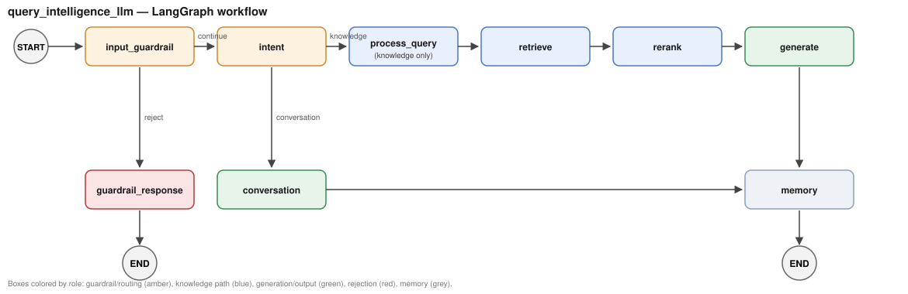

# Intelligent Document AI

> A **Document Intelligence System** built with **LangGraph**, **LangChain** and **FAISS**: guardrails, intent routing, hybrid retrieval with reranking, cited answers and conversational memory over your PDFs.



## Results so far

Measured on real documents; full write-ups are in [`docs/reports/`](docs/reports/).

| What was measured | Result | Report |
|---|---|---|
| Cross-encoder reranking (FAISS top-15 → top-3), 20 questions over two research papers | Fully correct answers **11/20 → 16/20**; false refusals **5 → 0**; confidently wrong **1 → 0** | [reranking validation](docs/reports/2026-07-24-reranking-validation.md) |
| Cost of that reranking step | **~700 ms** per query on CPU, ~125–180 ms on a GTX 1650 | [performance](docs/reports/2026-07-26-performance-and-deployment-readiness.md) |
| End-to-end knowledge query | **~0.9–1.1 s** (greetings that skip retrieval: ~0.3 s) | [performance](docs/reports/2026-07-26-performance-and-deployment-readiness.md) |
| 117-page history study guide, 92–97 graded questions | Answer correctness **82% → 85%**; mean latency **25.0 s → 12.7 s** after fixing intent classification | [full benchmark](docs/reports/2026-07-28-history-book-full-benchmark.md) |
| Repeated first-turn question | **14.5 s → 0 s**, zero LLM calls (response cache) | [full benchmark](docs/reports/2026-07-28-history-book-full-benchmark.md) |

Small samples, single-machine timings. Each report lists its own caveats.

**Status: pre-MVP.** Correctness is strong. Before any public deployment, the open gaps are API rate limiting, auth that fails open when `RAG_API_KEY` is unset, an unbounded session store, and monitoring (see the [deployment-readiness report](docs/reports/2026-07-26-performance-and-deployment-readiness.md)).

---

# Overview

Intelligent Document AI is designed to move beyond traditional Retrieval-Augmented Generation (RAG) systems by introducing an intelligent workflow layer capable of understanding user intent, validating requests, routing conversations, and retrieving the most relevant document context before generating responses.

The project follows a modular architecture where every stage of the workflow is isolated into reusable components, making it easy to extend, maintain, and scale.

Current implementation focuses on:

* LangGraph workflow
* Modular node architecture
* Input Guardrails
* Intent Detection
* Conversational AI
* Contextual Retrieval
* Evaluation Framework
* Structured Logging
* GPU Accelerated Embeddings

The long-term goal is to evolve this project into a complete enterprise-grade Document Intelligence Platform.

---

# Proof It Works

A real session against this codebase (`v0.0.1`, `RAGService` called directly
— no editing, no cherry-picked retries), showing intent routing, guardrails,
retrieval, and session-scoped memory all in one conversation:

```text
=== Turn 1: greeting (should skip retrieval entirely) ===
intent: greeting
answer: Hello! How can I assist you today?

=== Turn 2: knowledge question (triggers retrieval) ===
intent: knowledge
answer: Ajji is the grandmother.

=== Turn 3: pronoun follow-up (tests session memory + query rewriting) ===
intent: knowledge
rewritten_query: Activities of Ajji the grandmother
answer: She loved to tell wonderful stories, particularly in the late afternoon.

=== Turn 4: guardrail rejection (prompt injection) ===
status: rejected
answer: Prompt injection detected.
```

What each turn is actually demonstrating:

- **Turn 1** — intent classification correctly routes a greeting straight to
  conversation, skipping FAISS retrieval entirely (see `route_by_intent` in
  `src/workflow/workflow.py`).
- **Turn 2** — a real knowledge question hits the retriever against the
  ingested book and grounds the answer in retrieved context.
- **Turn 3** — "she" isn't resolvable from the query alone. `QueryRewriter`
  used the same session's prior turn to rewrite it to `"Activities of Ajji
  the grandmother"` before retrieval ran, and the answer is correct. Run
  this same query under a *different* `session_id` and it comes back
  unresolved and answers something else entirely — memory is genuinely
  session-scoped, not shared. See §12 of `DOCUMENTATION.md`.
- **Turn 4** — `PromptInjectionValidator` catches the attempt before it
  reaches intent detection or retrieval at all.

Reproduce it yourself:

```bash
python -c "
from src.services.rag_service import RAGService
rag = RAGService()
print(rag.ask('Hi there!', session_id='demo'))
print(rag.ask('Who is Ajji in this book?', session_id='demo'))
print(rag.ask('What did she love to do?', session_id='demo'))
"
```

(Needs a real FAISS index at `faiss_index/` — see `docs/03-development-guide.md`
if you're starting from a fresh clone with no index built yet.)

---

# Documentation

This README covers the feature list and roadmap. For the technical detail:

- [`SETUP.md`](SETUP.md) — clone-to-running-demo quickstart for a new
  developer: dependencies, credentials, getting a working FAISS index
  (gitignored, needs a manual copy — the guide explains why and how),
  running both APIs plus the frontend, and known gotchas.
- [`DOCUMENTATION.md`](DOCUMENTATION.md) — full architecture and
  module-by-module reference, including the history of the ingestion
  pipeline that used to live in this repo.
- [`docs/`](docs/) — deeper-dive docs: [architecture](docs/01-architecture.md),
  [RAG best practices](docs/02-rag-best-practices.md),
  [development guide](docs/03-development-guide.md),
  [contributing](docs/04-contributing.md), [roadmap](docs/05-roadmap.md),
  [release notes](docs/06-release-notes.md),
  [design decisions](docs/07-design-decisions.md).

This project pairs with a separate ingestion project
(`ingestion_fixed`, a sibling repo) that builds the FAISS index this
project reads from — see `docs/01-architecture.md` for how the two
connect, and `DOCUMENTATION.md` §8 for why ingestion no longer lives here.

**Status:** this repo is still pre-MVP and under active development —
unlike `ingestion_fixed`, which is considered stable. See `docs/05-roadmap.md`
for the concrete, current gap list.

---

# Features

## Current Features

* LangGraph Workflow Engine
* Modular Node Architecture
* FAISS Vector Database
* HuggingFace Embeddings
* Groq LLM Integration
* Conversation Memory
* Intent Detection
* Knowledge & Conversation Routing
* Input Guardrails
* Query Normalization
* Structured Logging
* Evaluation Pipeline
* GPU Support (CUDA)
* Production Ready Folder Structure

---

# Technology Stack

| Category        | Technology                             |
| --------------- | -------------------------------------- |
| Workflow        | LangGraph                              |
| LLM Framework   | LangChain                              |
| Embeddings      | sentence-transformers/all-MiniLM-L6-v2 |
| Vector Database | FAISS                                  |
| LLM             | Groq                                   |
| Language        | Python                                 |
| Logging         | Python Logging                         |
| Evaluation      | Custom Evaluation Framework            |
| Hardware        | CUDA / CPU                             |

---

# High-Level Architecture

```text
                        User
                          │
                          ▼
                 Input Guardrails
                          │
                          ▼
                 Intent Detection
                  ┌────────┴────────┐
                  ▼                 ▼
          Knowledge Query    Conversation Query
                  │                 │
                  ▼                 ▼
          Document Retrieval      LLM
                  │
                  ▼
           Context Generation
                  │
                  ▼
           Response Generation
                  │
                  ▼
          Conversation Memory
                  │
                  ▼
                 Response
```

---

# LangGraph Workflow

```text
                    START
                      │
                      ▼
             Input Guardrail
                      │
         ┌────────────┴────────────┐
         ▼                         ▼
 Guardrail Response           Intent Detection
         │                         │
         ▼                         ▼
        END                 Knowledge ?
                             ┌──────┴──────┐
                             ▼             ▼
                      Retrieve Context  Conversation
                             │             │
                             ▼             ▼
                      Generate Answer      │
                             │             │
                             └──────┬──────┘
                                    ▼
                              Update Memory
                                    │
                                    ▼
                                   END
```

---

# Current Directory Structure

```text
src/
│
├── api.py                 # standalone FastAPI service (POST /query, /reload)
│
├── evaluation/
│   ├── dataset/
│   ├── results/
│   ├── models.py
│   └── runner.py
│
├── guardrails/
│   ├── base.py
│   ├── input_guardrail.py
│   └── validators/
│       ├── empty_query.py
│       ├── length.py
│       ├── prompt_injection.py
│       ├── character.py
│       └── normalizer.py
│
├── prompts/
│   ├── generation.py
│   └── conversation.py
│
├── retrieval/
│   ├── config.py
│   ├── embeddings.py
│   ├── llm.py
│   ├── memory.py
│   ├── retriever.py
│   └── vectorstore.py
│
├── services/
│   └── rag_service.py
│
├── utils/
│   ├── decorators.py
│   └── logger.py
│
├── workflow/
│   ├── nodes/
│   │   ├── input_guardrail.py
│   │   ├── guardrail_response.py
│   │   ├── intent.py
│   │   ├── retrieve_context.py
│   │   ├── generate_knowledge.py
│   │   ├── generate_conversation.py
│   │   └── update_memory.py
│   │
│   ├── resources.py
│   ├── state.py
│   └── workflow.py
│
└── main.py
```

---

# Workflow Nodes

### Input Guardrail

Validates every incoming request before it enters the system.

Validators include:

* Empty Query Validation
* Length Validation
* Prompt Injection Detection
* Character Validation
* Query Normalization

---

### Intent Detection

Classifies the request into:

* Knowledge
* Greeting
* Chit Chat

This determines the execution path inside LangGraph.

---

### Retrieve Context

Responsible for

* Embedding Query
* FAISS Similarity Search
* Context Construction

---

### Generate Knowledge

Generates grounded answers using retrieved document context.

---

### Generate Conversation

Handles greetings and general conversational responses without document retrieval.

---

### Update Memory

Maintains conversation history for contextual interactions.

---

# Evaluation Framework

The project includes a custom evaluation framework capable of testing the complete workflow.

Current evaluation categories include:

* Knowledge Questions
* Greetings
* Chit Chat
* Out-of-Context Queries
* Empty Queries
* Whitespace Queries
* Prompt Injection
* Long Queries
* Query Normalization
* Rewrite Tests

Each evaluation records:

* Response
* Intent
* Latency
* Success Status
* Metadata

Results are automatically exported as CSV reports.

---

# Input Guardrails

Current Guardrails include:

* Empty Query Validator
* Length Validator
* Prompt Injection Validator
* Character Validator
* Query Normalizer

Future Guardrails:

* PII Detection
* Toxicity Detection
* Language Detection
* Sensitive Information Detection
* Role Validation

---

# Logging

Every workflow node provides structured logs including:

* Node Start
* Node Completion
* Execution Time
* Retrieval Statistics
* Intent Detection
* Context Length
* Guardrail Results

This significantly improves debugging and production observability.

---

# GPU Support

The embedding model automatically detects the available hardware.

Priority:

```text
CUDA GPU
    ↓
CPU
```

Tested on:

* NVIDIA GTX 1650
* CUDA 12.x
* PyTorch CUDA Build

---

# Current Project Status

## Completed

* Modular Project Structure
* LangGraph Workflow
* GPU Accelerated Embeddings
* Intent Classification
* Knowledge Routing
* Conversation Routing
* Input Guardrails
* Conversation Memory
* Evaluation Framework
* Structured Logging
* Production Resource Management
* Query Rewriting
* Metadata-aware Retrieval and Metadata Filtering
* Cross-encoder Reranking
* Hybrid Search (BM25 + dense, Reciprocal Rank Fusion)
* Parent-Child Retrieval
* Source Citations (provenance of the chunks used)
* Streaming Responses
* Response Cache
* API Authentication (shared key)

---

## Next

* Better Chunk Selection
* Context Compression
* Multi-document Retrieval
* Observability and Metrics Dashboard
* Rate Limiting
* Auth that fails closed when no key is configured

---

## Phase 5 — Agentic Intelligence

* Multi-Agent Workflow
* Document Planning
* Tool Calling
* SQL + Document Routing
* Web Search Integration
* Autonomous Research

---

# Running the Project

## Clone Repository

```bash
git clone "https://github.com/yugmint/query_intelligence_llm.git"

cd query_intelligence_llm
```

---

## Create Virtual Environment

```bash
python -m venv venv
```

---

## Install Dependencies

```bash
pip install -r requirements.txt
```

---

## Configure Credentials

Create a `cred.json` file:

```json
{
    "grok_api_key": "YOUR_GROQ_API_KEY"
}
```

---

## Run Application

```bash
python main.py
```

---

## Run as a Standalone API

For deployment alongside `ingestion_fixed`'s own API, sharing one FAISS
index via a mounted volume (see the top-level `docker-compose.yml`, one
directory up):

```bash
RAG_API_KEY=your-shared-secret uvicorn src.api:app --reload --port 8001
curl -X POST http://localhost:8001/query -H "Content-Type: application/json" \
     -H "X-API-Key: your-shared-secret" \
     -d '{"query": "your question here", "session_id": "optional-per-user-id"}'
```

`RAG_API_KEY` is optional for local dev (omit it and the API runs
unauthenticated with a warning) but required before exposing this beyond
localhost. `session_id` is optional too — omit it to use one shared
conversation, or pass a distinct id per user/session to keep conversations
isolated.

See `docs/01-architecture.md` and `DOCUMENTATION.md` §12 for details,
including the `/reload` endpoint and a known bootstrap-order gotcha.

---

## Run Tests

```bash
pytest tests/ -v
```

Covers the guardrail validator chain and every workflow node, including
reranking (200+ tests, all mocked LLM/retriever/reranker, no real network
calls); see `docs/03-development-guide.md`.

## Run Evaluation

```bash
python -m src.evaluation.runner
```

Evaluation reports will be generated under:

```text
src/evaluation/results/
```

---

# Future Roadmap

```text
Phase 1
Production RAG Workflow
✔ Completed

Phase 2
Intelligence Layer
✔ Completed

Phase 3
Advanced Retrieval
✔ Mostly completed (context compression pending)

Phase 4
Enterprise Features
⏳ In Progress (citations, streaming, auth done)

Phase 5
Agentic AI Platform
```

---

# Design Philosophy

The architecture follows a modular design where each component has a single responsibility.

* Guardrails validate requests.
* Workflow nodes orchestrate execution.
* Retrieval components manage document search.
* Services coordinate application logic.
* Evaluation continuously validates system performance.

This separation of concerns enables maintainability, extensibility, and production scalability.

---

# License

This project is intended for educational, research, and production experimentation purposes. Licensing can be updated based on deployment requirements.
